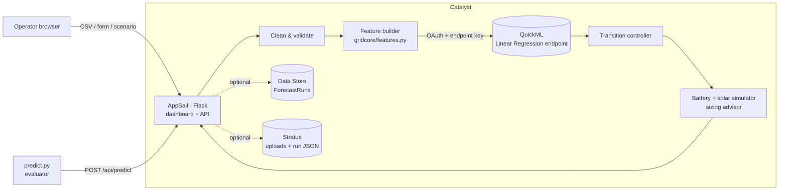

# GridMind: Microgrid Demand Forecasting & Dispatch

**HackSphere 3.0 · Zoho Catalyst (AppSail + QuickML)**

GridMind forecasts a microgrid's hourly energy demand for the next 24 hours with a regression model trained and served by **Catalyst QuickML**. It turns the forecast into power-source switching signals (Main Grid ↔ Renewable Battery Storage) and raises overload alerts. It then simulates whether the battery can actually carry that plan, and what the plan saves in cost and CO₂.

| | |
|---|---|
| **Live app** | https://gridmind-50047185567.development.catalystappsail.in |
| **Prediction API** | `POST https://gridmind-50047185567.development.catalystappsail.in/api/predict` |
| **GitHub** | https://github.com/yashviharia/GridMind |

---

## Highlights

| | |
|---|---|
| **8.96 kW RMSE on unseen future data** | Physics-informed features (hourly base load + cooling load above 24 °C, split by time of day) let a linear QuickML model beat every tree ensemble tried. It is **34% lower** than out-of-the-box gradient boosting (13.55 kW) and **80% lower** than the starter kit's baseline formula (45.9 kW). QuickML's own test split: **RMSE 8.7 kW, R² 0.97**. |
| **Verified train/serve parity** | One feature module (`appsail/gridcore/features.py`) builds the QuickML training CSV *and* every inference request. On a 400-hour check, the live endpoint stays within 0.83 kW of the reference model. |
| **Uncertainty, not just a number** | Every hour gets a 90% prediction interval and a **probability of overload**, taken from the empirical distribution of held-out errors. |
| **Spec-exact controller, tested** | The transition rules live in a small module with boundary tests (160 vs 160.01 kW, 17:00/18:00/22:00/23:00, 199.99 vs 200 kW). |
| **Battery feasibility + sizing advisor** | An hour-by-hour simulation with solar charging shows when the battery runs dry. A binary search finds the **smallest battery that covers every storage-mode hour**. |
| **Cost & carbon** | Savings in ₹ and tonnes of CO₂ against running on the grid all day, with time-of-day tariffs. |
| **What-if** | Slide temperature from −8 to +6 °C and watch load, alerts and the battery plan update live. |
| **Explainable** | Click any hour to see base vs weather-driven load, plus **QuickML SHAP attributions** from the endpoint's model explainer. |
| **Robust ingestion** | CSV upload, a manual 24-hour editor, or one-click scenarios. Interpolates missing values, rejects impossible readings, de-duplicates, fills gaps up to 6 h, accepts header aliases, and **lists every fix it made**. |

---

## Architecture



**Request flow:** raw telemetry → cleaning (validation, imputation, gap filling) → 11 engineered features → QuickML prediction → controller rules → battery simulation → dashboard and API response.

- **One public URL.** The dashboard is served by the AppSail app itself, so the UI and API share an origin and there is no cross-origin auth to manage.
- **Secrets stay server-side.**
  - QuickML credentials live only in AppSail environment variables, generated from a local, gitignored `.env` at build time.
  - The app mints OAuth access tokens from a refresh token and caches them until they near expiry.
  - `predict.py` calls the app's `/api/predict` proxy, so evaluators need no credentials.
- **Honest degradation.**
  - If QuickML is unreachable, the dashboard keeps working on a local mirror of the same linear model, and the header badge says so.
  - `/api/predict` never falls back silently; it returns 502. A successful evaluation therefore always means QuickML answered.

### API

| Method & path | Purpose |
|---|---|
| `GET /` | Dashboard |
| `GET /health` | Liveness check |
| `GET /api/status` | QuickML configuration, storage mode, model report |
| `GET /api/scenarios`, `GET /api/scenarios/<id>` | Built-in 24 h scenarios (heatwave, summer, spring, winter) |
| `POST /api/forecast` | Full pipeline. JSON `{"rows": [...]}`, `{"csv": "..."}`, `{"scenario": "heatwave"}`, or a multipart CSV file. Optional battery settings and temperature offset. |
| `POST /api/predict` | Evaluator contract: `{"data": [rows]}` → `{"predictions": [...], "source": "quickml"}` |
| `POST /api/explain` | QuickML SHAP explanation for one hour |
| `GET /api/history`, `GET /api/history/<id>` | Recent forecast runs |

---

## The model

The training data (4,000 hourly rows) has two dominant effects:

1. **A stepped daily profile.** Night ≈ 92 kW, a morning ramp 06–09, a daytime plateau, and an evening peak 18–22 ≈ 215 kW. There is no weekday effect.
2. **A cooling load** that switches on at **24 °C** and adds roughly 8–11 kW per °C, with a slope that depends on time of day. Humidity is almost a mirror image of temperature (r = −0.94), so it adds little.

The test window (mid-June to July) is hotter than most of the training data. Linear terms in "degrees above 24 °C" extend cleanly into that range, whereas tree models flatten out at the edge of what they have seen. That is why the simpler model wins:

| Model (rolling-origin CV, 4 × 400 h folds) | RMSE kW |
|---|---|
| **Linear regression, 11 engineered features** | **8.96** |
| Gradient boosting, raw 4 columns | 9.93 |
| Gradient boosting, engineered features | 10.23 |
| Random forest, engineered features | 11.45 |
| Gradient boosting, raw 4 columns, default settings | 13.55 |
| Starter-kit dummy formula | 45.94 |

**Features sent to QuickML:** `ambient_temp_c, humidity_pct, solar_irradiance_wm2, hour_base_load, cooling_deg, heating_deg, cool_night, cool_morning, cool_day, cool_evening, is_evening_peak`.

`hour_base_load` is a fixed per-hour lookup learned from mild training days. It is a deterministic transform of the timestamp, stored in `model_params.json` and used identically in training and inference.

**QuickML pipeline:** the dataset is `quickml/quickml_train.csv` with target `target_demand_kw`. It feeds straight into the Linear Regression stage, with the Model Explainer enabled.

## Transition controller

| Condition (per forecast hour) | Signal |
|---|---|
| demand > 160 kW **or** 18:00 ≤ hour ≤ 22:00 | `RENEWABLE_STORAGE` |
| otherwise | `MAIN_GRID` |
| demand ≥ 200 kW (independent of mode) | `overload_alert = true` |

The battery simulation is **advisory**: it never changes these signals. It reports where the battery would need grid backup, so operators see the plan's feasibility next to the rules.

---

## Setup

The full step-by-step guide is in **[SETUP.md](SETUP.md)**. The short version:

### 1. Run locally

```bash
git clone https://github.com/yashviharia/GridMind.git && cd GridMind
python3 -m venv .venv
.venv/bin/pip install pandas numpy scikit-learn flask requests pytest certifi
.venv/bin/python -m pytest -q tests          # 20 tests
cd appsail && ../.venv/bin/python app.py     # http://localhost:9000
```

Without QuickML credentials everything runs on the local mirror model, and the header badge says so.

### 2. Train and publish the QuickML model

1. **QuickML → Datasets → Import:** upload `quickml/quickml_train.csv`. To regenerate it, run `.venv/bin/python ml/train.py`.
2. **Pipelines → Regression:**
   - Set target `target_demand_kw` and use the **Linear Regression** algorithm.
   - Enable **Model Explainer**.
   - Don't add feature-selection or PCA stages.
3. **Models → Create endpoint → Publish.** Note the endpoint key, project ID and org ID.

### 3. Configure credentials

```bash
cp .env.example .env    # fill in QUICKML_PROJECT_ID, QUICKML_ENDPOINT_KEY, ZOHO_ORG_ID,
                        # ZOHO_CLIENT_ID, ZOHO_CLIENT_SECRET (Self Client at api-console.zoho.in)
# Self Client -> Generate Code, scope QuickML.deployment.READ, 10 min, then:
.venv/bin/python scripts/get_refresh_token.py --write-env --code <grant-code>
.venv/bin/python scripts/check_quickml.py    # expect: PASS: QuickML matches the expected model
```

### 4. Deploy to AppSail

```bash
npm install -g zcatalyst-cli && catalyst login
catalyst init --project <project_id> --org <org_id> -ni
scripts/build_appsail.sh     # vendors Linux wheels + writes build/app-config.json from .env
catalyst appsail:add --name gridmind --stack python_3_12 --source "$PWD/appsail/build" \
  --build ./ --command "python3 app.py" -ni
catalyst deploy --only appsail:gridmind -ni
```

To redeploy after a change: `scripts/build_appsail.sh && catalyst deploy --only appsail:gridmind -ni`.

### 5. Evaluate

```bash
python predict.py --input sample_test_input.csv --output predictions.csv
python test_eval.py          # prints SUCCESS
```

`predict.py` tries three sources in order:
1. QuickML directly, if `.env` credentials are present.
2. The live app's `/api/predict`. This is the default for evaluators.
3. A local mirror model, with a loud warning.

---

## Environment variables

Set these in `.env` for local runs. `scripts/build_appsail.sh` copies them into the AppSail config at deploy time, and `.env` is gitignored.

| Variable | Required | Purpose |
|---|---|---|
| `QUICKML_PROJECT_ID` | ✅ | Catalyst project ID (in the QuickML endpoint URL) |
| `QUICKML_ENDPOINT_KEY` | ✅ | Sent as `X-QUICKML-ENDPOINT-KEY`; from QuickML → Endpoints |
| `ZOHO_ORG_ID` | ✅ | Sent as the `CATALYST-ORG` header |
| `ZOHO_CLIENT_ID`, `ZOHO_CLIENT_SECRET` | ✅ | Self Client credentials from api-console.zoho.in |
| `ZOHO_REFRESH_TOKEN` | ✅ | Long-lived token, scope `QuickML.deployment.READ`; the app mints access tokens from it |
| `ZOHO_ACCESS_TOKEN` | — | Alternative to the refresh flow for quick local tests (expires after 1 h; ignored when a refresh token is set; never deployed) |
| `QUICKML_API_HOST` | — | Default `https://api.catalyst.zoho.in` (India DC); use `.com`, `.eu`, … to match your account |
| `ZOHO_ACCOUNTS_URL` | — | Default `https://accounts.zoho.in` |
| `QUICKML_ENVIRONMENT` | — | `Development` (default) or `Production`, sent as the `Environment` header |
| `QUICKML_TIMEOUT_S` | — | QuickML request timeout, default 15 s |
| `GRIDMIND_STORAGE` | — | `catalyst` to persist runs to Data Store + Stratus; default `memory` |
| `GRIDMIND_TABLE` | — | Data Store table, default `ForecastRuns` |
| `GRIDMIND_BUCKET` | — | Stratus bucket for uploads and run JSON |
| `GRIDMIND_PREDICT_URL` | — | Override the `/api/predict` URL used by `predict.py` |

AppSail sets `X_ZOHO_CATALYST_LISTEN_PORT` itself. Locally the app defaults to port 9000.

---

## Repository layout

```
predict.py                 evaluator entry point (QuickML direct → app API → local mirror)
test_eval.py               official self-test (unchanged)
appsail/
  app.py                   Flask API + dashboard (AppSail entry point)
  app-config.json          AppSail runtime config template (no secrets)
  gridcore/
    features.py            single source of truth for model inputs
    cleaning.py            validation, imputation, gap filling, issue log
    quickml_client.py      QuickML REST client: OAuth refresh, batching, SHAP
    controller.py          transition rules
    battery.py             battery/solar simulation, tariffs, sizing advisor
    forecast.py            pipeline orchestration, intervals, overload probability
    store.py               Data Store + Stratus persistence (in-memory fallback)
    model_params.json      hour profile, mirror coefficients, error distribution
  static/                  dashboard (HTML/CSS/JS + Chart.js)
ml/train.py                builds quickml/quickml_train.csv, cross-validates models
quickml/quickml_train.csv  QuickML training dataset
scripts/
  build_appsail.sh         AppSail bundle + config from .env
  get_refresh_token.py     Zoho OAuth grant code → refresh token (writes .env)
  check_quickml.py         live endpoint parity check
tests/                     controller + pipeline tests (pytest)
```
