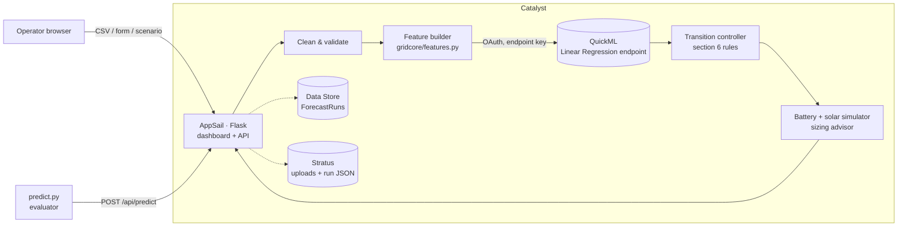

# GridMind: Microgrid Demand Forecasting & Dispatch

**HackSphere 3.0 · Zoho Catalyst (AppSail + QuickML + Data Store + Stratus)**

GridMind forecasts a microgrid's hourly energy demand for the next 24 hours with a model trained and served by **Catalyst QuickML**. It turns the forecast into power-source switching signals (Main Grid ↔ Renewable Battery Storage) and raises overload alerts. It then simulates whether the battery can actually carry the plan, and what that plan saves.

**Live app:** [gridmind-50047185567.development.catalystappsail.in](https://gridmind-50047185567.development.catalystappsail.in) · **Prediction API:** `POST /api/predict`

---

## Highlights

| | |
|---|---|
| **8.96 kW RMSE on unseen future data** | Physics-informed features (hourly base load + cooling load above 24 °C, split by time of day) let a linear QuickML model beat every tree ensemble tried. It is **34% lower** than out-of-the-box gradient boosting (13.55 kW) and **80% lower** than the starter kit's baseline formula (45.9 kW). |
| **Uncertainty, not just a number** | Every hour gets a 90% prediction interval and a **probability of overload**, from the empirical distribution of held-out errors. Hours just under 200 kW are flagged as "at risk". |
| **Spec-exact controller, tested** | The section 6 rules live in a 40-line module with boundary tests (160 vs 160.01 kW, 17:00/18:00/22:00/23:00, 199.99 vs 200 kW). |
| **Battery feasibility + sizing advisor** | An hour-by-hour simulation with solar charging shows when the battery runs dry. A binary search finds the **smallest battery that covers every storage-mode hour**. |
| **Cost & carbon** | Savings in ₹ and tonnes of CO₂ against running on the grid all day, with time-of-day tariffs. |
| **What-if** | Slide temperature from −8 to +6 °C and watch load, alerts and battery plan update live. |
| **Explainable** | Click any hour to see base vs weather-driven load and per-feature contributions (QuickML SHAP when the endpoint has the explainer enabled). |
| **Robust ingestion** | CSV upload, manual 24-hour editor, or one-click scenarios. Interpolates missing values, rejects impossible readings, de-duplicates, fills gaps up to 6 h, accepts header aliases, and **lists every fix** it made. |
| **Train/serve parity** | One feature module (`appsail/gridcore/features.py`) builds the QuickML training CSV *and* every inference request, and a parity checker verifies the live endpoint. |

---

## Architecture



- **Same-origin by design:** the dashboard is served by the AppSail app itself. That avoids the Slate ↔ AppSail cross-origin auth problem and gives one public URL for the whole workflow.
- **Secrets stay server-side:** QuickML OAuth credentials live in AppSail environment variables. Access tokens are minted from a refresh token and cached. `predict.py` calls the app's `/api/predict` proxy, which runs the identical pipeline and calls QuickML, so no secrets ship in the repo.
- **Graceful degradation:** if QuickML is unreachable, the dashboard keeps working on a local mirror of the same linear model and says so in the header badge. `/api/predict` never falls back silently: it returns 502, so a successful evaluation always means QuickML answered.

## The model

The training data is hourly and synthetic-looking, with two dominant effects:

1. **A stepped daily profile.** Night ≈ 92 kW, a morning ramp 06–09, a daytime plateau, and an evening peak 18–22 ≈ 215 kW. There is no weekday effect.
2. **A cooling load** that switches on at **24 °C** and adds ≈ 8–11 kW per °C, with a slope that depends on the time of day. Humidity is almost a mirror image of temperature (r = −0.94), so it adds little.

The test window (mid-June to July) is hotter than most of the training data. Linear terms in "degrees above 24 °C" extend cleanly into that range, whereas tree models flatten out at the edge of what they have seen. That is why the simpler model wins:

| Model (rolling-origin CV, 4 × 400 h folds) | RMSE kW |
|---|---|
| **Linear regression, 11 engineered features** | **8.96** |
| Gradient boosting, engineered features | 10.23 |
| Gradient boosting, raw 4 columns | 9.93 |
| Random forest, engineered features | 11.45 |
| Gradient boosting, raw 4 columns, default settings | 13.55 |
| Starter-kit dummy formula | 45.94 |

Features sent to QuickML: `ambient_temp_c, humidity_pct, solar_irradiance_wm2, hour_base_load, cooling_deg, heating_deg, cool_night, cool_morning, cool_day, cool_evening, is_evening_peak`. `hour_base_load` is a fixed per-hour lookup learned from mild training days (a deterministic transform of the timestamp), stored in `model_params.json` and used identically in training and inference.

Reproduce: `.venv/bin/python ml/train.py`.

## Transition controller

| Condition (per forecast hour) | Signal |
|---|---|
| demand > 160 kW **or** 18:00 ≤ hour ≤ 22:00 | `RENEWABLE_STORAGE` |
| otherwise | `MAIN_GRID` |
| demand ≥ 200 kW (independent of mode) | `overload_alert = true` |

The battery simulation is **advisory**: it never changes these signals. It reports where the battery would need grid backup, so operators see the plan's feasibility next to the rules.

## Repository layout

```
predict.py                 evaluator contract (QuickML direct → app proxy → local mirror)
test_eval.py               official self-test (unchanged)
appsail/
  app.py                   Flask API + static dashboard (AppSail entry point)
  app-config.json          AppSail runtime config (python_3_12)
  gridcore/
    features.py            single source of truth for model inputs
    cleaning.py            validation, imputation, gap filling, issue log
    quickml_client.py      QuickML REST client with OAuth refresh + batching
    controller.py          section 6 rules
    battery.py             battery/solar simulation, tariffs, sizing advisor
    forecast.py            pipeline orchestration, intervals, overload probability
    store.py               Data Store + Stratus persistence (in-memory fallback)
    model_params.json      hour profile, mirror coefficients, error distribution
  static/                  dashboard (HTML/CSS/JS + Chart.js)
ml/train.py                builds quickml/quickml_train.csv, validates models
quickml/quickml_train.csv  upload this to QuickML
scripts/                   build, OAuth token helper, QuickML parity check
tests/                     controller + pipeline tests (pytest)
```

## Running locally

```bash
python3 -m venv .venv && .venv/bin/pip install pandas numpy scikit-learn flask requests pytest
.venv/bin/python ml/train.py          # rebuild training CSV + params (optional)
.venv/bin/python -m pytest -q tests   # 20 tests
cd appsail && ../.venv/bin/python app.py   # http://localhost:9000
python test_eval.py                   # official pre-submission check
python predict.py --input sample_test_input.csv --output predictions.csv
```

Without QuickML credentials everything runs on the local mirror model, and the header badge says so.

## Environment variables

See `.env.example`. Set them in `appsail/app-config.json` → `env_variables` for deployment. A redeploy **replaces** Console-set values, so keep them in the file and never commit real secrets.

| Variable | Purpose |
|---|---|
| `QUICKML_API_HOST` | e.g. `https://api.catalyst.zoho.in` (match your data center) |
| `QUICKML_PROJECT_ID` | Catalyst project ID |
| `QUICKML_ENDPOINT_KEY` | from Console → QuickML → Endpoints |
| `ZOHO_ORG_ID` | sent as the `CATALYST-ORG` header |
| `ZOHO_CLIENT_ID`, `ZOHO_CLIENT_SECRET`, `ZOHO_REFRESH_TOKEN` | Self Client OAuth, scope `QuickML.deployment.READ` |
| `ZOHO_ACCOUNTS_URL` | e.g. `https://accounts.zoho.in` |
| `QUICKML_ENVIRONMENT` | `Development` or `Production` |
| `GRIDMIND_STORAGE` | `catalyst` to persist runs to Data Store/Stratus, else `memory` |
| `GRIDMIND_TABLE`, `GRIDMIND_BUCKET` | Data Store table and Stratus bucket names |
| `GRIDMIND_PREDICT_URL` | (predict.py) `https://<app>/api/predict` |

Full step-by-step setup: **[SETUP.md](SETUP.md)**.
